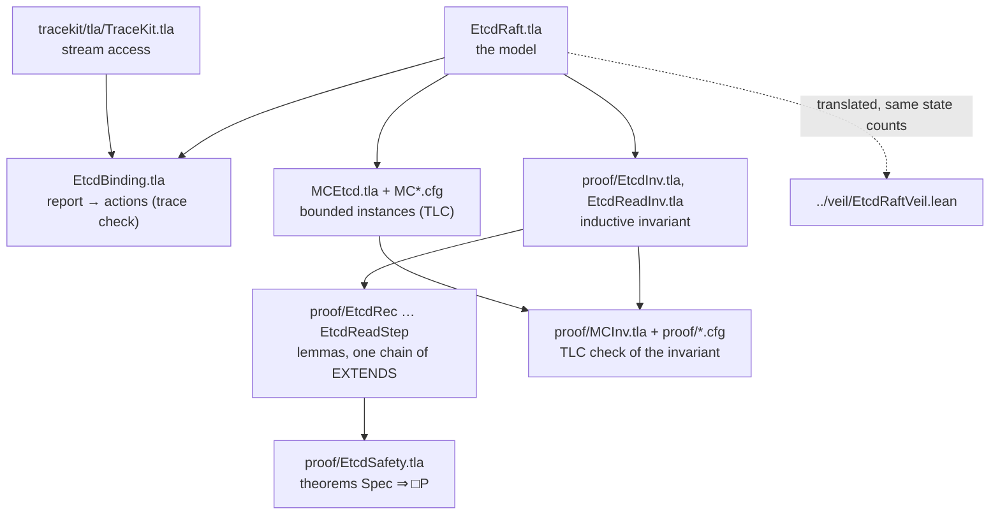

# The model of etcd-io/raft

[`EtcdRaft.tla`](EtcdRaft.tla) is a model of etcd-io/raft as an application drives it through `RawNode`.
One action is one thing visible at raft's boundary: one change of a node's disk, one message
that may be sent, or one thing a leader does in memory that other nodes can come to depend
on. Messages are facts in a set that only grows; any fact can be acted on at any later time,
any number of times, which covers delay, loss, duplication and reordering.

**A node's variables are what it has on disk.** `currentTerm`, the vote, `log` and
`commitIndex` of node i are its durable state. A leader's in-memory log is `ledLog[t]`, the
log of the leader of term t: `LeaderAppend` adds to it, `SendAppend` sends from it, and the
leader's own disk receives entries like any follower's (a request to itself, then `Ack`).
Nothing in the model says when a node writes, so three ways of driving raft are behaviours
of the same model and are covered by the same proofs: write each `Ready` then send; a leader
that sends while it writes; and `AsyncStorageWrites`. Every prefix of the actions that make
up one write is itself a state of the model, so the model allows more than the code does.

## What is modelled

| Feature | Modelled | Notes |
|---|---|---|
| Leader election, voting, terms | ✅ | A vote is one write (`CastVote`); a request for votes is made from what is on the candidate's disk (`StartElection`) |
| Log replication, conflict deletion, heartbeats | ✅ | A leader may send any segment of its leader log at any time; a heartbeat is a request with no entries |
| Commitment and application | ✅ | `LeaderCommit` records a commit; `FollowerCommit` moves a node's durable commit index; `Apply` may run ahead of the durable commit index (as with `AsyncStorageWrites`) |
| Crash and restart | ✅ | `Restart` keeps the disk; the commit index is durable |
| `AsyncStorageWrites`, leader sending before its write | ✅ | By the on-disk encoding above; with patch E1, or the application holding vote requests until their write |
| Snapshots: taken, sent, restored | ✅ | A node's log is its whole log; a snapshot sent by a leader is a request carrying the committed prefix; `Restore`, `RestoreConf` |
| Membership changes: add/remove voters, joint configurations (`ConfChange`, `ConfChangeV2`), auto and explicit leave | ✅ | A change takes effect when applied (`SwitchConf`), as in raft; any set of changes (constant `ConfChanges`) |
| Read index (`ReadIndex` with `ReadOnlySafe`) | ✅ | One read followed from request to confirmation, any one (`ReadRequest`, `ReadAck`, `ReadConfirm`) |
| PreVote, CheckQuorum, leadership transfer, proposal forwarding, flow control | ✅ (followed, not modelled) | They only change *when* raft takes modelled steps; the trace check follows them as steps without a model action |
| Learners | ✅ (as non-voters) | Raft's learner bookkeeping only decides which nodes a leader sends to; the model lets a leader send to any node |
| Lease-based reads (`ReadOnlyLeaseBased`) | ❌ | Depends on clocks |
| Raft's `Node` wrapper, `Bootstrap` | ❌ | `rawnode` drives `RawNode` directly (batching inputs as `Node` does); nodes start from a given voter set |
| Liveness | ❌ | Safety only |

## Safety properties

Defined at the end of [`EtcdRaft.tla`](EtcdRaft.tla). Proved means: for any finite set of servers, any
non-empty initial voter set, any set of possible membership changes, any number of terms
and entries.

| Property | Statement | TLAPS | Lean |
|---|---|---|---|
| `ElectionSafety` | At most one server is elected in a term | ✅ | ✅ |
| `LogMatching` | Two logs with an entry of the same term at an index agree up to that index | ✅ | ✅ |
| `CommitSafety` | Two committed prefixes never disagree | ✅ | ✅ |
| `StateMachineSafety` | No two state machines are handed different entries at one index | ✅ | ✅ |
| `LeaderCompleteness` | The leader log of a term has every prefix committed under an earlier term | ✅ | ✅ |
| `ReadIndexSafety` | When a read may be served, its index covers every prefix committed when it was requested | ✅ | ✅ |
| `OneVotePerTerm` | A node never votes for two candidates in one term | – | ✅ |
| `CommittedEntriesPreserved` | What a node's commit index covers is in its log and is a committed prefix | – | ✅ (as two invariants, with `CommitWithinLog`) |
| `LeaderLogIsLed`, `RequestsFromLed`, `ConfirmedWithinLog` | The model's bookkeeping (`ledLog`, `confirmed`) is consistent | – | ✅ |
| `ConfIsCommitted`, `LeaderConf` | A node's configuration is made by committed changes; a leader's is made by its own log, with at most one change pending | – | ✅ |
| `ReadMsgsOld`, `ReadFloorOld`, `ReadFloorBound` | The followed read's recorded state is consistent | – | ✅ |
| `TermMonotonic`, `CommitMonotonic`, `NoAppliesSkipped` | Properties of steps (not state invariants) | – | – |

With `CommitSafety` and `StateMachineSafety`, `ReadIndexSafety` gives linearizable reads.
The step properties are checked by TLC on bounded instances and by the driver on every run.

## Files

| File | Role |
|---|---|
| [`EtcdRaft.tla`](EtcdRaft.tla) | The model: `Init`, `Next`, `Spec`, the properties |
| [`EtcdBinding.tla`](EtcdBinding.tla) | Trace spec: reads the stream of reports and maps each to model actions. [`EtcdBinding*.cfg`](./) (3 or 5 nodes, empty or bootstrapped logs, membership changes) and [`manifest*.json`](./), which tell [`tracekit/check/streamcheck.py`](../tracekit/check/streamcheck.py) what to run |
| [`MCEtcd.tla`](MCEtcd.tla) | Bounds, symmetry, and restricted next-state relations for TLC |
| [`MC*.cfg`](./) | Bounded instances, below. Generated with the manifests by [`../scripts/gen-configs.sh`](../scripts/gen-configs.sh) from one table (`--check` verifies them) |
| [`proof/`](proof/) | TLAPS proofs ([`proof/README.md`](proof/README.md)); [`proof/SPEC.sha256`](proof/SPEC.sha256) pins the spec files they are about |

## Bounded instances (TLC)

`Count` instances use the unrestricted `Spec` with no symmetry, for comparison with Veil's
model checker ([`../veil/README.md`](../veil/README.md)). Each completes with no violation unless marked.

| Config | Servers (voters) | Changes | Bounds (terms, log, batch, msgs) | Result |
|---|---|---|---|---|
| [`MCCount2.cfg`](MCCount2.cfg) / [`MCCount3.cfg`](MCCount3.cfg) | 3 (3) | none | 2, 2, 1, 2/3 | 17,168 / 305,896 states |
| [`MCCount4.cfg`](MCCount4.cfg) | 3 (3) | none | 1, 1, 1, 6 | 1,631,864 states (an entry is committed, applied and read) |
| [`MCMemCount2.cfg`](MCMemCount2.cfg) / [`MCMemCount3.cfg`](MCMemCount3.cfg) | 3 (2) | one: add the third | 2, 2, 1, 2/3 | 15,800 / 204,552 states |
| [`MCReadMem3.cfg`](MCReadMem3.cfg) | 3 (2) | one, with reads | 2, 2, 1, 4 | 1,312,146 states |
| `MCTiny5`, `MCTiny7`, `MCFullTiny5`, `MCMemTwo`, `MCMem3`, `MCReadMemTwo` | 2–3 | none / small | 1–2, 2, 1, 5–7 | run to a time limit; no violation, depth 18–20 reached |
| `MCSim`, `MCMemSim`, `MCReadMemSim` | 3 | none / small | 3–4, 3–4, 2, 16–24 | random simulation (`-simulate`) |
| [`MCBoot.cfg`](MCBoot.cfg) | 3 (3) | none | 1, 1, 1, 5 | shows the bootstrapped start state is reachable (reports `NotBooted` violated, by design) |

## Trace validation

[`../rawnode/`](../rawnode/) drives a `RawNode` and reports each step before it happens: what raft did in
memory (`mem`, `ready`), each write announced before it is made (`write`, `flush`) and
confirmed after (`wrote`, `made`), each message sent and received, each apply, snapshot,
configuration switch and read index. The service ([`../server/`](../server/)) and the simulator
([`../sim/`](../sim/)) both run their nodes through it. A collector merges the reports into one
stream; TLC follows it as it is written, one model state per report, with no search.

| Report | Model actions |
|---|---|
| `boot` | `Restart` (undoing the last announced write if it did not happen), `Restore` |
| `ready` / `mem` | `BecomeCandidate`, `BecomeFollower`, `BecomeLeader`, `LeaderAppend`, `LeaderCommit` |
| `write` (or `flush`, with batching) | In order: `StartElection` or `AdoptTerm`; `CastVote`; `DeleteSuffix`, `StoreEntries`; `Ack`; `FollowerCommit` |
| `net` (with batching) | none; the `flush` steps must add up to exactly the write raft asked for |
| `send` vote request / vote reply / append reply | must be the fact the write created; `GrantVote`; `Ack` or `AckCommitted` |
| `send` append request, heartbeat, snapshot | the guard of `SendAppend` (a segment of the term's leader log) |
| `apply` | `Apply` for each entry |
| `conf` | `SwitchConf`; raft's reported voters must equal the model's |
| `restore` | `Restore`; the snapshot's voters must be those its entries make |
| `readreq`, `read` | none; the given index must cover every commit recorded at the request (`ReadIndexSafety`) |

At every step the trace spec checks the safety properties above on a summary of the model's
history. A run fails at the first report the model cannot take (`REJECTED k`) or the first
state that violates a property (`VIOLATED k`). It also reports `CommitBeyondConfirmed`,
`Unpromotable` (a node outside its configuration wins an election) and `ReadIndexStale`.

The check is itself tested: [`../scripts/validator-tests.sh`](../scripts/validator-tests.sh) (recorded streams accepted; 60
mutations rejected at the mutated event or the first that depends on it) and
[`../scripts/sut-mutants.sh`](../scripts/sut-mutants.sh) (55 runs of raft or `rawnode` with a seeded bug, each rejected).

### Modes

The same variables select the mode in [`../scripts/local-run.sh`](../scripts/local-run.sh) and [`../scripts/launch.sh`](../scripts/launch.sh);
the simulator takes the flags in `SIMARGS` of [`../scripts/sim-batch.sh`](../scripts/sim-batch.sh).

| Local / Antithesis | Simulator | Mode |
|---|---|---|
| (default) | (default) | One atomic write per `Ready` (bbolt transaction), then send, then apply |
| `PARALLEL=1` | `-parallel` | A leader sends before its write |
| `ASYNC=1` | `-async` | `AsyncStorageWrites`; the node holds vote requests until their write. `NO_HOLD_VOTE=1` / `-nohold`: upstream behaviour (rejected, E1) |
| `PATCH=E1` | `PATCH=E1` | Build against raft with patch E1 |
| `READ_INDEX=1` | `-reads` | Linearizable reads by `ReadIndex`, served on any node |
| `SNAPSHOT_EVERY=n`, `SNAP_STATUS=1` | `-snap`, `-snapstatus` | Snapshots in place of the log; `ReportSnapshot` |
| `FORWARD=1` | `-forward` | Followers forward proposals to the leader |
| `BATCH=n`, `BATCH_WAIT` | `-batch` | One `Ready` and one write for several inputs (as raft's `Node` does) |
| `TRANSFER_RATE` | `-transfer` | Leadership transfer |
| `PREVOTE=1`, `CHECK_QUORUM=1` | `-prevote`, `-checkquorum` | Raft options |
| `MAX_INFLIGHT=n` | `-inflight n` | Flow control |
| `VOTERS=…`, `CONF_RATE`, `STEP_DOWN=1` | `-member` with `VOTERS=n` | Membership changes; `StepDownOnRemoval` |
| `BOOT_ENTRY=0` | `BOOT=0` | Logs start empty instead of with one service-written entry |
| `NODES=5`, `CHAOS=1` | node count argument | Five nodes; crashes, pauses, partitions |
| – | `-split ORDER` | Storage writes split in the given order (below) |

## Assumptions and limitations

What the proofs assume:

- `Server` is finite and `InitVoters` is a non-empty subset of it (`ASSUME ServerFinite`,
  `VotersOK`). Nothing else.
- The proofs are about the model. That raft follows it is established by the trace check,
  on the behaviours the runs reach.

**Write order.** The model's steps for one `Ready` are `AdoptTerm`, then `CastVote`, then
`DeleteSuffix`/`StoreEntries`, then `FollowerCommit`, and storing entries of a request
requires the node's durable term to be the request's. A crash may fall between any two. So
the proofs cover these storage disciplines:

| How the application writes a `Ready` | Covered |
|---|---|
| Entries and HardState in one atomic, synced write | ✅ The service and every run do this |
| Term and vote; then entries; then commit index | ✅ Every intermediate state is a model state (`-split term-entries-commit`) |
| Entries; then HardState (the order raft's README gives for non-atomic storage) | Partly. A crash that loses a new term leaves entries of a term the node has not recorded, which is not a model state: neither proved nor refuted, and the check stops there (`-split entries-hardstate`). With membership changes, this order enables E3 |
| HardState; then entries | ❌ Unsafe: a crash leaves a commit index past the log, and raft panics on restart (`-split hardstate-entries`) |

What the trace check takes on trust:

- **`rawnode` reports what it does**, on the node's goroutine, before the step: a message is
  reported then handed to the transport, a write announced then made. [`sut-mutants.sh`](../scripts/sut-mutants.sh)
  includes seeded bugs in `rawnode`, each rejected.
- **The disk.** A bbolt transaction is all-or-nothing across a crash and synced data
  survives. Antithesis crashes processes; it does not lose synced writes.
- **With batching,** the term, vote, commit index and role reported after each input come
  from raft's `BasicStatus`. A wrong report would make the steps fail to add up to the write
  (`net`) and be rejected, not accepted. Unchecked: the order of two inputs' effects inside one
  write when they cancel before anything is written or sent.
- **One write per write raft asks for.** Several queued writes made as one with
  `AsyncStorageWrites` are not covered.
- **Reports of one node arrive in order and none is lost** (one socket per node; a gap in
  sequence numbers stops the check with an error).
- **`AsyncStorageWrites` contract kept by the application:** writes in order, one at a time;
  a write's responses after it; snapshots only up to the durable commit index, while nothing
  is applied and no leader snapshot waits to be written. The check sees violations of the
  first two; the last is enforced by `rawnode`'s storage refusing an older snapshot.
- **Forgotten facts.** The trace spec drops votes, acknowledgements and leader logs of terms
  every node has left (TraceKit's convention 4). A wrong choice can only reject a valid run.
- **The trace spec.** [`EtcdBinding.tla`](EtcdBinding.tla) extends the model and binds each report to a
  sequence of its actions, written out by hand as one step (`InMemory`, `OnDisk`), and the
  summary that `Safe` is evaluated on replaces the model's `commits` and `applied`. That
  each step is a sequence of model steps, and that `Safe` implies the model's properties,
  is argued, not checked; [`validator-tests.sh`](../scripts/validator-tests.sh) and
  [`sut-mutants.sh`](../scripts/sut-mutants.sh) test it on samples.

Where the model differs from the code on purpose:

- **Follower commit rule.** A follower commits only within what the leader of the request's
  term has confirmed of its log (`confirmed`). The code commits up to the last entry of the
  request (or, on a heartbeat, the leader's bound); both are within `confirmed`, and a run
  where they are not is reported (`CommitBeyondConfirmed`).
- **Logs are whole.** A node that keeps a snapshot in place of a log prefix still has that
  prefix in the model.
- **Logs start empty.** A cluster whose service writes a first entry starts, in the trace
  spec, in the model state after a first election whose leader added that entry and every
  node stored it (`BootInit`; [`MCBoot.cfg`](MCBoot.cfg) shows the state is reachable).
- **A node outside its configuration** may win an election in the model. Raft forbids it
  (`promotable`); the trace check reports `Unpromotable` if it happens.
- **Read index.** The trace check verifies `ReadIndexSafety` directly on every read rather
  than replaying `ReadRequest`/`ReadAck`/`ReadConfirm`. TLC does not reach a wrong read index
  even with the quorum rule broken, so for reads with membership changes the proofs are the
  evidence.

Not covered:

- Lease-based reads, `Bootstrap`, an application that declines to apply a membership
  change, raft's `Node` wrapper, liveness, the state machine's contents (the driver checks
  the sums clients see).
- Model checking with membership changes is bounded: TLC does not exhaust an instance with
  more than one change.
- A TLC behaviour holds at most 65,535 states, so the driver ends a timeline before that.
